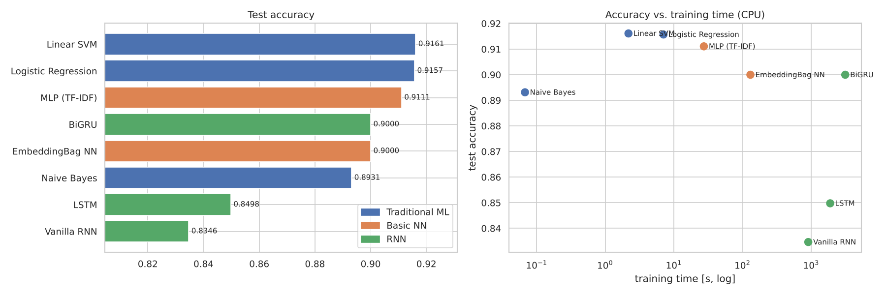

# IMDB Sentiment Analysis: RNNs vs. Basic Neural Networks vs. Traditional ML

Sentiment classification on the Kaggle dataset [IMDB Dataset of 50K Movie Reviews](https://www.kaggle.com/datasets/lakshmi25npathi/imdb-dataset-of-50k-movie-reviews).
The notebook trains recurrent neural networks and compares them with feed-forward ("basic") neural networks and with traditional machine-learning models.
All models use the same train/validation/test split (80/10/10, duplicates removed first).

Everything is in **[`sentiment_analysis.ipynb`](sentiment_analysis.ipynb)**. It is saved with outputs, so you can read the results without running it.

## Models

| Family | Model | Input |
|---|---|---|
| Traditional ML | Logistic Regression, Linear SVM, Multinomial Naive Bayes | TF-IDF, uni+bigrams (200k features) |
| Basic NN | MLP: `Linear(20k→256) → ReLU → Dropout → Linear` | TF-IDF, uni+bigrams (20k features) |
| Basic NN | EmbeddingBag: averaged word embeddings → dense layer (ignores word order) | word sequences |
| RNN | Vanilla RNN, LSTM, bidirectional GRU (embedding 128, hidden 64, packed sequences) | word sequences (last 256 tokens) |

## Results (test set, 4,959 reviews)

| Model | Family | Accuracy | F1 | ROC-AUC | Training time (CPU) |
|---|---|---|---|---|---|
| Linear SVM | Traditional ML | **0.9161** | **0.9172** | **0.9728** | 2 s |
| Logistic Regression | Traditional ML | 0.9157 | 0.9166 | 0.9723 | 7 s |
| MLP (TF-IDF) | Basic NN | 0.9111 | 0.9111 | 0.9709 | 27 s |
| EmbeddingBag NN | Basic NN | 0.9000 | 0.9002 | 0.9593 | 2 min |
| BiGRU | RNN | 0.9000 | 0.9027 | 0.9637 | 52 min |
| Naive Bayes | Traditional ML | 0.8931 | 0.8938 | 0.9569 | < 1 s |
| LSTM | RNN | 0.8498 | 0.8562 | 0.9318 | 31 min |
| Vanilla RNN | RNN | 0.8346 | 0.8343 | 0.8941 | 15 min |



**Key findings** (full discussion at the end of the notebook):
- **TF-IDF + linear models were the most accurate and by far the fastest.** IMDB sentiment is carried mostly by strong individual words and phrases, which a bag of n-grams captures well.
- **The vanilla RNN was the weakest model** and is worst on the longest reviews: the vanishing-gradient problem.
  Gated RNNs fix this; the **BiGRU** gained 6.5 points over the vanilla RNN.
- **Word order added little here.** The order-agnostic EmbeddingBag network matched the BiGRU at a fraction of the cost.
  The RNNs were limited by learning their embeddings from scratch, truncation to 256 tokens, and an 8-epoch CPU budget: the LSTM and BiGRU were still improving when they stopped.

Other figures are in [`results/`](results/): EDA, training curves and confusion matrices. Per-model metrics are in `results/metrics.csv`.

## How to run

```bash
pip install -r requirements.txt
```

1. Download the dataset from the Kaggle page above and extract `IMDB Dataset.csv` into `data/`, so the file is at `data/IMDB Dataset.csv`.
   Alternatively, with Kaggle API credentials set up, the notebook downloads it with `kagglehub`. On Kaggle itself, attach the dataset as an input and the notebook finds it automatically.
2. Open `sentiment_analysis.ipynb` and run all cells.

PyTorch uses an NVIDIA GPU automatically if one is available.
On a GPU the whole notebook runs in about 5–10 minutes. CPU-only, it takes about 1–2 hours, almost all of it RNN training.
To let the LSTM and BiGRU train fully, raise `epochs=8` to `epochs=15` in sections 6.2 and 6.3; early stopping still applies.
